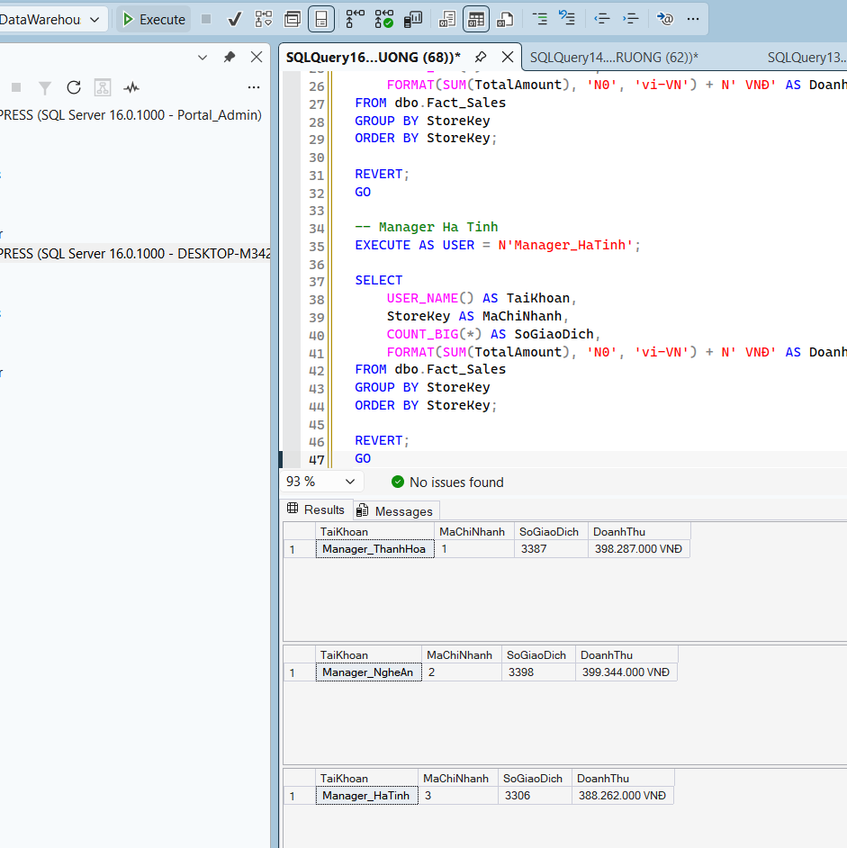
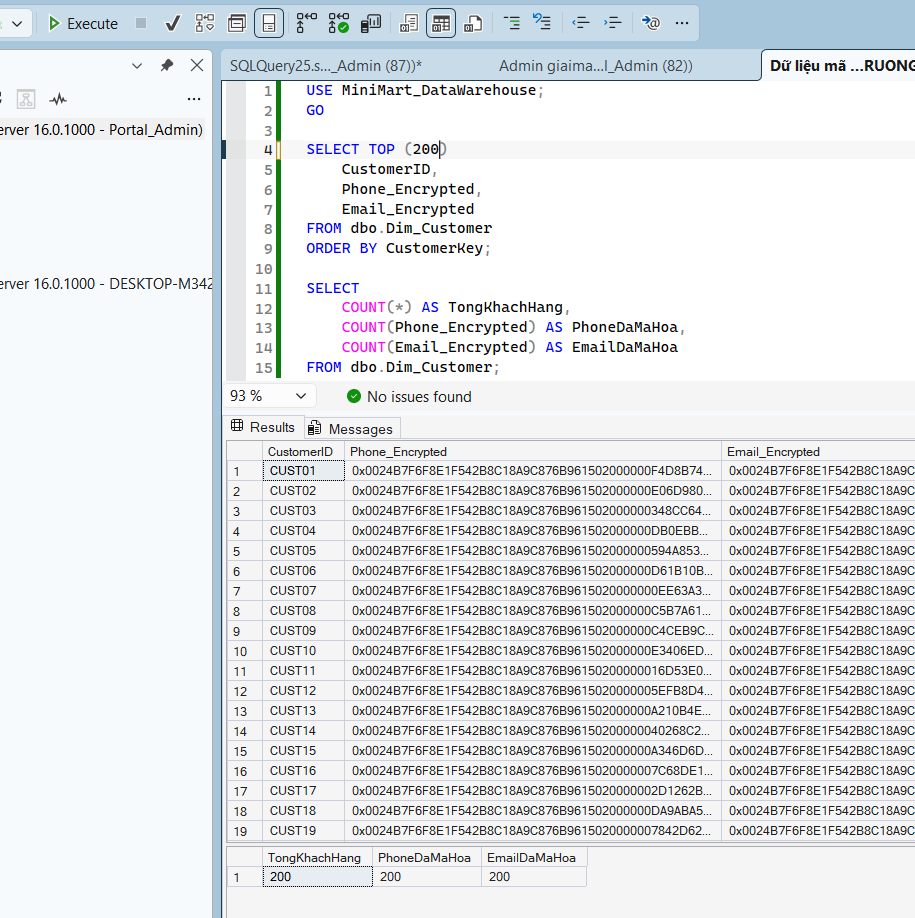

# Mini-Mart Data Warehouse Security & Access Control

An individual implementation by **Le Thuan Truong**, Data Engineering student at the Posts and Telecommunications Institute of Technology (PTIT).

This course project combines a SQL Server sales warehouse with a Python/Flask portal to demonstrate authentication, role-based access control, row-level security, column-level permissions, encryption, and auditing.

## Implemented scope and verified sample

| Component | Scope |
|---|---|
| Business warehouse | 1 fact table, 4 dimensions |
| Sample transactions | **10,091** |
| Customers / products / branches | **200 / 50 / 3** |
| Date dimension | **91 days** |
| Sample revenue | **VND 1,185,893,000** |
| Business roles | Admin, Manager, Staff, Auditor; a separate service role supports MFA/logging |
| Contact ciphertext | Phone and email ciphertext present for **200/200 customers** in the exported sample |

The broader schema includes supporting security tables, an HR table, a view, and account-management procedures. It contains 13 tables and 14 stored procedures in total; not all of those procedures are exposed by the portal or covered by the report's demo.

### Authentication and sessions

- Validates a SQL Login password before TOTP enrollment/verification.
- Encrypts stored TOTP seeds with a locally generated Fernet key.
- Rejects reused TOTP time steps and temporarily locks repeated failed attempts.
- Maintains authenticated sessions in server process memory; SQL passwords remain in that process memory to support user-specific SQL connections.
- Current configuration: **10-minute idle timeout**, **8-hour absolute timeout**. Earlier report/guide snapshots used different idle settings.
- Applies CSRF checks to POST requests and checks live SQL role membership for protected portal pages.

### Authorization and data protection

- Business queries use the authenticated user's SQL credentials so SQL Server permissions and RLS remain effective.
- `Security.UserStoreAccess` determines allowed branches; UI branch filters only narrow that scope.
- Staff reads four allowed customer columns; contact fields are denied by column permissions.
- Portal Admin retrieves decrypted customer contacts through `Security.usp_PortalGetDecryptedCustomers`.
- The web role-transfer wrapper is intentionally restricted to **RBAC_Test_01**, switching Staff/Auditor roles for demonstration.
- Admin can grant/revoke the three named managers' branch mappings through controlled stored procedures.

### Auditing

- SQL Server Audit records SELECT/INSERT/UPDATE/DELETE access attempts on `dbo.Dim_Customer` and `dbo.Fact_Sales` according to the exported specification.
- Application logs provide portal-level activity and denied-access context.
- The two log sources have different scopes and do not need matching row counts.

## Verification screenshots



This screenshot documents the earlier per-branch baseline: 3,387 / 3,398 / 3,306 transactions. The **current exported mappings contain 7 rows**: Thanh Hoa's manager is additionally authorized for Nghe An, while Portal Admin is mapped to all three branches. This change is deliberate and explains why the current manager scope may differ from the historical screenshot.



Non-NULL ciphertext counts alone do not establish complete protection of data at rest or successful decryption. The exported database retains plaintext Phone and Email alongside ciphertext.

## Repository layout

```text
app.py / db.py / mfa.py / config.py
portal_routes.py / portal_data.py / session_lifecycle.py
templates/                 Flask/Jinja pages
static/                    CSS and JavaScript
sql/exported/              Supplied schema, sample data, and Audit configurations
sql/setup-templates/       New-environment Login/key templates and separate log-event correction
sql/demo/                  Demo checks and metadata inventory scripts
tests/                     SQL-independent session lifecycle tests
docs/                      Setup notes, known gaps, and screenshots
requirements.txt
config.env.example         Reference environment settings; not automatically loaded
```

## Local setup and execution

**Read [docs/SETUP.md](docs/SETUP.md) before running SQL.** The exported schema/data files are for a separately rebuilt environment; running them on an existing demo database can cause duplicate-object or duplicate-data errors and change permissions.

Prerequisites: Windows SQL Server 2022 (or a compatible reviewed configuration), SSMS, Python 3.10+, and Microsoft ODBC Driver 18 for SQL Server (or a configured alternative).

From the project root:

```powershell
py -m venv .venv
.\.venv\Scripts\Activate.ps1
python -m pip install -r requirements.txt
```

After the separate SQL environment is configured, set the process environment variables listed in `config.env.example`:

```powershell
$env:MM_SQL_SERVER = 'YOUR_SEPARATE_SQL_INSTANCE'
$env:MM_SQL_DATABASE = 'MiniMart_DataWarehouse'
$env:MM_SVC_USER = 'Portal_Service'
$env:MM_PORTAL_ADMIN_LOGINS = 'Portal_Admin'
$env:MM_COOKIE_SECURE = '0'
```

`CHAY_MINIMART_DEMO.bat` invokes the included PowerShell launcher, which prompts for the new local service password, performs startup checks, and starts Flask. Review `MM_SQL_SERVER` before using it. Open `http://127.0.0.1:5000/login` and enroll new MFA identities in the rebuilt environment.

`config.env.example` is documentation only: this application reads process environment variables and does not automatically parse an `.env` file.

## Checks and limits of verification

```powershell
python tests/test_session_lifecycle.py
```

Eight existing session lifecycle tests passed during packaging, and the included Python sources were checked for syntax. The sample export was parsed without executing SQL: primary keys are unique, all sales foreign keys resolve, and branch counts/revenue match the report.

**The complete fresh installation, SQL templates, SQL Server permission tests, ODBC connection, and end-to-end portal have not been executed on a new SQL Server instance during packaging.** This repository is a documented course demo, not a verified one-click installer or a production deployment.

Two legacy Flask integration test files assumed the older `/home` response and were not included as passing tests for the current portal. Backup and UI patch-generator scripts were also excluded from the runtime package.

## Packaging changes and known gaps

- Original running code, schema and sample data are preserved; supplied SQL exports are normalized to UTF-8 with BOM.
- Added documentation, `.gitignore`, config reference, selected demo checks, and new-environment Login/encryption templates.
- Added `40_Align_portal_audit_events.sql` separately: the exported log procedure rejects four action names used by Flask (`RBAC_ROLE_TRANSFER`, `STORE_ACCESS_GRANT`, `STORE_ACCESS_REVOKE`, `STORE_ACCESS_FAILED`). The correction retains the old names and adds these names. It has not been applied to the original database.
- No `.venv`, runtime Flask/Fernet keys, credentials, MFA table contents, login history, or SQL Audit log files are bundled.
- See [docs/KNOWN_LIMITATIONS.md](docs/KNOWN_LIMITATIONS.md) for remaining constraints.

## References

- [SQL Server security documentation](https://learn.microsoft.com/en-us/sql/relational-databases/security/security-center-for-sql-server-database-engine)
- [Row-level security](https://learn.microsoft.com/en-us/sql/relational-databases/security/row-level-security)
- [SQL Server Audit](https://learn.microsoft.com/en-us/sql/relational-databases/security/auditing/sql-server-audit-database-engine)
- [Flask](https://flask.palletsprojects.com/)
